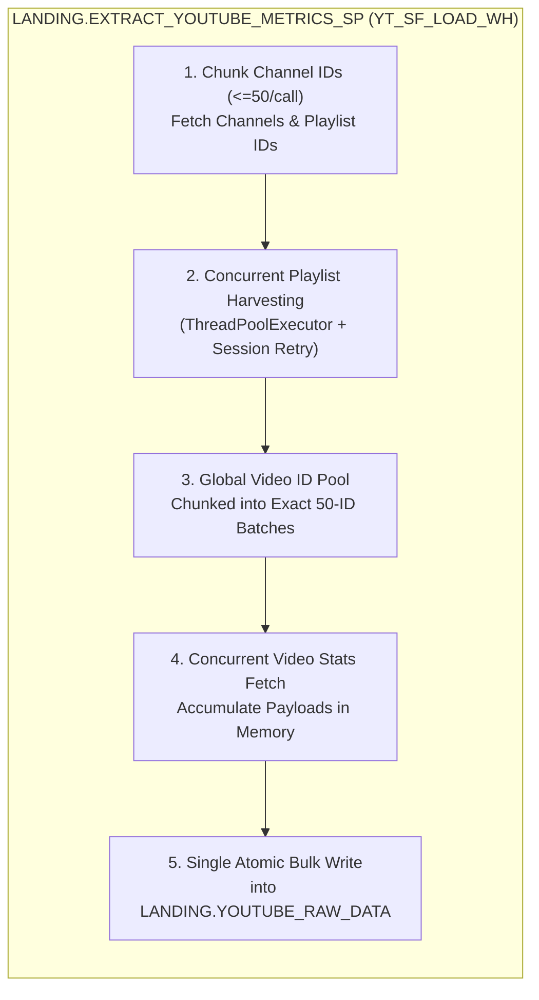

# ADR 018: Snowpark YouTube API Extraction Optimization (Bulk DML & Concurrent I/O)

## Status
Accepted (Reviewed & Approved by Principal Data Architect)

## Context
As our tracked Hungarian YouTube channel portfolio grew to 44+ channels with thousands of historical videos, the daily execution of `LANDING.EXTRACT_YOUTUBE_METRICS_SP` on the `YT_SF_LOAD_WH` warehouse began consuming an unsustainable amount of Snowflake credits, threatening the 15-credit monthly cap enforced by `YT_SF_LOAD_RM`.

We evaluated whether to migrate the YouTube API extraction layer out of Snowflake (e.g., to GitHub Actions or AWS Lambda writing to S3) or optimize the existing Snowpark Python Stored Procedure natively.

### Root Cause Analysis of Credit Consumption
An architectural audit of `snowflake/01_landing/06_procedures/EXTRACT_YOUTUBE_METRICS_SP.sql` revealed that the high credit burn is **not** an inherent limitation of Snowpark, but the result of four compounding OLTP and I/O anti-patterns executing on an analytical columnar warehouse:
1. **Row-by-Row DML Inside Loops (Primary Bottleneck):** The procedure executed an individual `INSERT INTO LANDING.YOUTUBE_RAW_DATA (RAW_JSON) SELECT PARSE_JSON(...)` statement for every single channel (44 times) and for every 50-video batch (hundreds of times per run). Because Snowflake is an OLAP columnar database, each standalone `INSERT` incurs query compilation, transaction locking, metadata synchronization, and micro-partition creation overhead (~1–2 seconds per statement).
2. **Unbatched Channel Metadata Requests:** The `/youtube/v3/channels` endpoint was queried sequentially 1-by-1 in a loop (`44` HTTP requests) despite the YouTube Data API v3 supporting up to `50` comma-separated channel IDs per call.
3. **Per-Channel Video Batch Fragmentation:** Video IDs were chunked into batches of 50 *inside* each channel's loop rather than across the global list of harvested video IDs, creating up to 44 partially filled "tail" HTTP requests and redundant `RAW_JSON` rows.
4. **Single-Threaded Synchronous HTTP I/O:** All `playlistItems` pagination loops and `videos` batch requests executed synchronously on a single thread without TCP connection pooling (`requests.get()`), forcing the `YT_SF_LOAD_WH` virtual warehouse to sit idle and billed by the second while waiting on external network round-trips.

### Why Moving Extraction Out of Snowflake Was Rejected
1. **PRD & Architecture Violation:** Our Product Requirements Document (`.agents/rules/00-product-vision.md` § 4.2) and Data Architecture (`.agents/rules/01-data-architecture.md` § 1) explicitly mandate native extraction via Snowpark Python Stored Procedures using Snowflake External Network Access and native Snowflake Tasks.
2. **Regression Against ADR-016:** In **ADR-016**, we intentionally eliminated external GitHub Actions cron runners to unify scheduling, security, and orchestration natively inside Snowflake. Offloading extraction to GitHub Actions or AWS Lambda would re-introduce split orchestration and force us to duplicate `TECH.YOUTUBE_API_KEY_SECRET` outside Snowflake's RBAC governance boundary.
3. **The Agentic Pivot Principle:** Per our Agentic Conceptual Framework (`conceptual_framework.md` § 7), we never abandon an architectural boundary until algorithmic optimizations have been exhausted.

## Decision
We will **retain the native Snowpark extraction architecture** inside Snowflake and refactor `LANDING.EXTRACT_YOUTUBE_METRICS_SP` around four architectural patterns:

1. **In-Memory Payload Accumulation & Single Atomic Bulk Write:**
   * All raw JSON API responses (both `youtube#channelListResponse` and `youtube#videoListResponse` payloads) will be accumulated in a Python list in memory during the extraction run.
   * Instead of executing `INSERT` inside the HTTP loops, the procedure will write all payloads into `LANDING.YOUTUBE_RAW_DATA` in a **single bulk operation** at the conclusion of the script, preserving the `EXTRACTED_AT DEFAULT CURRENT_TIMESTAMP()` column semantics.
2. **Chunked Channel API Lookups (50-ID Ceiling Safe):**
   * Channel IDs will be chunked into batches of up to **50 IDs per request** (`id=id1,id2,...`). For 44 channels this requires 1 request, and as the portfolio grows past 50 channels it automatically scales in 50-channel increments without breaking the YouTube API limit.
   * Because `V_YOUTUBE_PARSED_CHANNELS` uses `LATERAL FLATTEN(INPUT => RAW_JSON:items)`, a single multi-channel `youtube#channelListResponse` payload is 100% compatible with existing downstream views.
3. **Global Video ID Pooling Before 50-ID Batching:**
   * Because `V_YOUTUBE_PARSED_VIDEOS` extracts `value:snippet.channelId::STRING` directly from each video item inside `RAW_JSON:items`, video batches do not need to be isolated by channel.
   * All harvested `video_ids` across all channels will be pooled into a single deduplicated collection before slicing into 50-ID batches, eliminating up to 43 partially filled tail requests per run.
4. **Concurrent HTTP Fetching with Resilient Connection Pooling:**
   * We will use Python's `concurrent.futures.ThreadPoolExecutor` (`max_workers=8`) alongside `requests.Session()` configured with `urllib3.util.retry.Retry` (exponential backoff on HTTP `429`, `500`, `502`, `503`, `504`) to parallelize playlist pagination and video batch requests safely.

## Consequences
* **Positive (90–95% Credit Reduction):** Eliminating hundreds of sequential `INSERT` transactions and parallelizing HTTP calls drops total procedure runtime from many minutes to under 30 seconds, billing near the 60-second minimum quantum (~0.016 credits/run, or **~0.5 credits/month**).
* **Positive (Timestamp Determinism at Midnight):** Writing all rows in a single atomic transaction guarantees every record in a daily run receives an identical `EXTRACTED_AT` timestamp, preventing intra-run midnight boundary skew in `stg_youtube_channel_stats` and `stg_youtube_video_stats`.
* **Positive (Zero Infrastructure Sprawl & Downstream Transparency):** Preserves 100% alignment with `.agents/rules/00-product-vision.md`, `.agents/rules/01-data-architecture.md`, and **ADR-016**. `LANDING.YOUTUBE_RAW_DATA`, `LANDING.YOUTUBE_RAW_DATA_STREAM`, `RAW.LOAD_YOUTUBE_RAW_DATA_TASK`, and all downstream dbt models remain untouched.
* **Negative (All-or-Nothing Memory Buffer):** Accumulating JSON payloads in memory before flushing means an unhandled fatal exception aborts the entire landing load. This is mitigated via HTTP retry adapters and per-channel playlist exception logging.

## Architectural Guardrails for Implementation (For Data Engineer)
* **Snowpark Schema & `DEFAULT CURRENT_TIMESTAMP()` Trap:** `LANDING.YOUTUBE_RAW_DATA` has two columns: `(RAW_JSON VARIANT, EXTRACTED_AT TIMESTAMP_NTZ DEFAULT CURRENT_TIMESTAMP())`. Do **not** call `df.write.save_as_table("LANDING.YOUTUBE_RAW_DATA", mode="append")` on a 1-column DataFrame without handling column mapping, or it will fail with a column-count mismatch. Instead, stage a temporary Snowpark DataFrame of raw JSON strings and execute a single `INSERT INTO {{SNOWFLAKE_DATABASE}}.LANDING.YOUTUBE_RAW_DATA (RAW_JSON) SELECT PARSE_JSON($1) FROM <temp_df_or_values>`, or pass explicit columns.
* **Avoid String-Concatenated SQL Injection/Escaping:** Do not build a massive multi-megabyte raw SQL string using `.replace("'", "''")`. Use Snowpark's `session.create_dataframe` (which binds parameters safely via Arrow/Stage under the hood) and select `parse_json` into `LANDING.YOUTUBE_RAW_DATA (RAW_JSON)`.
* **Snowpark Bulk DataFrame Session Schema Context Trap:** When `session.create_dataframe()` is called with a large list (>1,000 rows), Snowpark internally stages a temporary object and executes a `DROP` during cleanup. If the procedure is invoked manually from a Snowsight Worksheet where no active schema is selected in the UI dropdown (`CURRENT_SCHEMA() IS NULL`), Snowflake raises `090106 (22000): Cannot perform DROP. This session does not have a current schema`. Guard against this at the start of `main(session)` with `if not session.get_current_schema(): session.sql("USE SCHEMA {{SNOWFLAKE_DATABASE}}.LANDING").collect()` (conditional so it never triggers a `USE statement not allowed` error inside a Snowflake Task, where the schema context is already set to `LANDING`).
* **Per-Channel Fault Isolation:** If a single channel's `uploads` playlist returns a 404 (e.g., a newly created channel with zero videos), log a warning and continue harvesting the remaining channels rather than failing the entire procedure.
